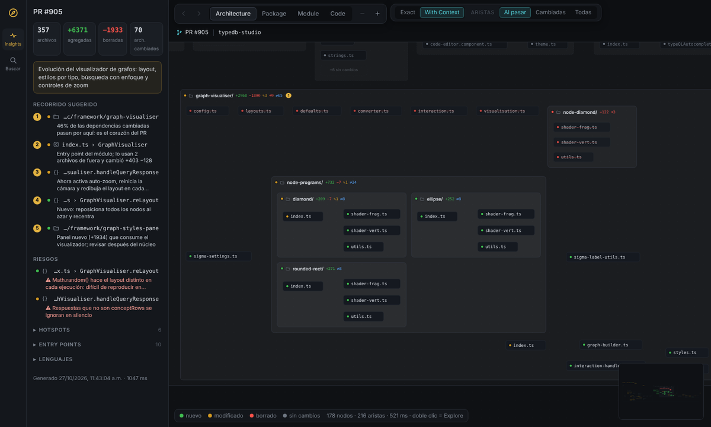
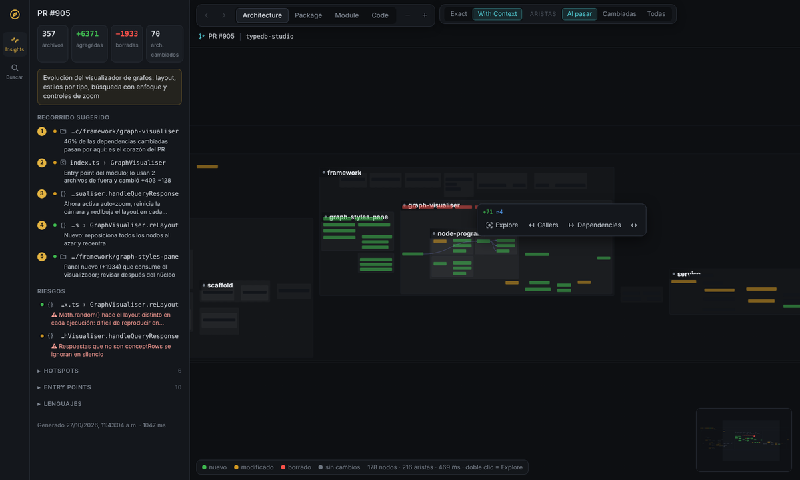
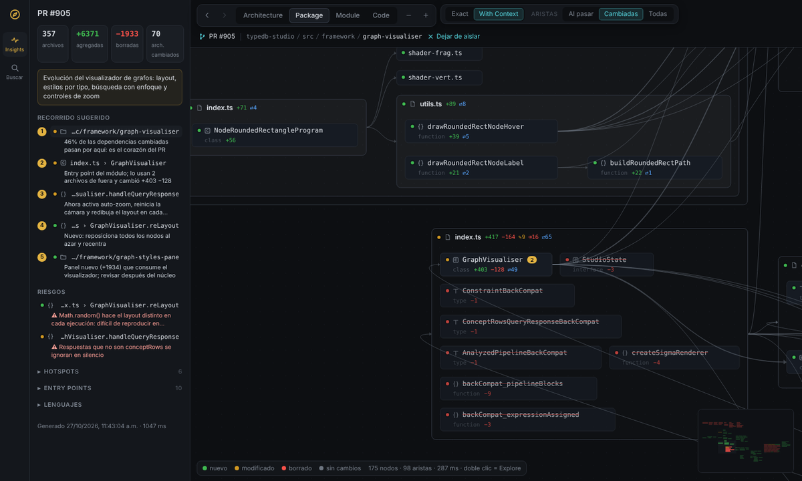
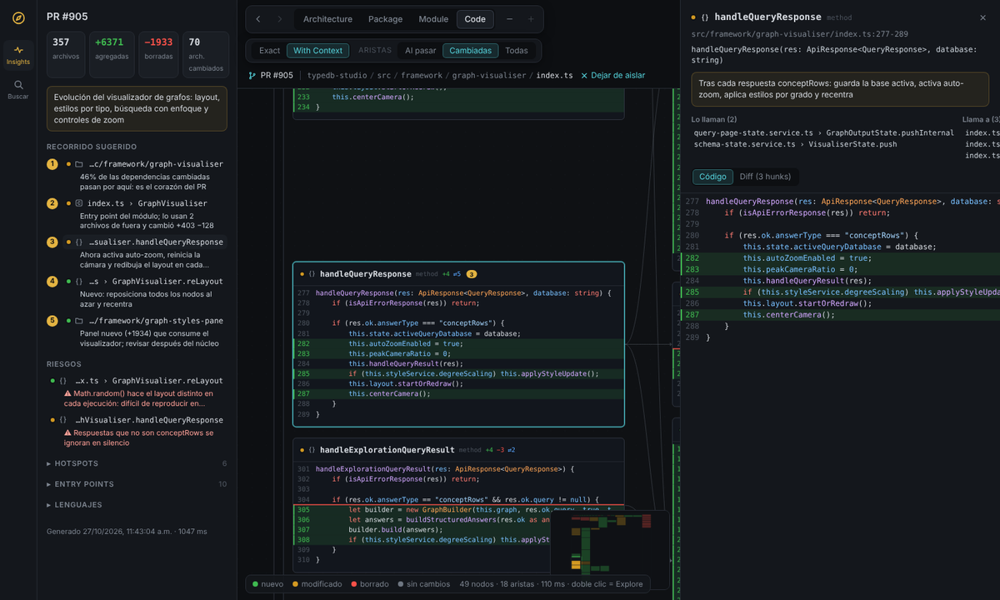

# Compass

[](https://github.com/CrisMtz99/Compass_DiffMap/actions/workflows/ci.yml)

**Mapa navegable de repositorios y diffs.** Compass convierte un repo, un diff o un pull request en cajas anidadas con zoom semántico — *Architecture → Package → Module → Code* — para que veas por dónde pasan los cambios antes de leer una sola línea. **DiffMap** es el concepto: revisar código (sobre todo el que escribe la IA) como un mapa y no como una lista de 70 archivos.

Inspirado en un reel de graphicule.dev ("AI code diffs are a nightmare"); esta es una implementación propia.



## Tres modos

| Modo | Cuándo | Comando |
| --- | --- | --- |
| **Map** | Heredas o creas un repo: documentar y verificar la estructura | `compass map --doc docs/ARCHITECTURE.md` |
| **Diff** | Desarrollo, debugging y mantenimiento | `compass diff` (base configurada → árbol de trabajo) |
| **PR** | Revisar un pull request de GitHub (GitLab después) | `compass pr 905` o `compass pr <url>` |

`compass serve --open` abre la app con controles para los tres modos. Dentro de Claude Code, la skill [`compass`](skill/compass/SKILL.md) corre el análisis al terminar cada cambio y agrega un **recorrido de revisión**, **resúmenes** y **riesgos** que la app muestra al instante.

## Qué ves en la app

- **Cajas anidadas** carpeta → archivo → clase → método. El estado lo marca el punto (verde nuevo, ámbar modificado, rojo borrado, gris sin cambios) y el anidado se lee por el fondo. Métricas: `+agregadas −borradas ✎modificados ⌫borrados ⇄dependencias`.
- **Cuatro niveles**: Architecture (carpetas y archivos), Package (archivos con sus símbolos), Module (miembros de cada clase con sus llamadas), Code (el código de cada método con las líneas del diff).
- **Detalle según el zoom**: de lejos, nombres de módulos y barras de color tipo mapa de calor; de cerca, todo el detalle.
- **Aristas bajo demanda**: *Al pasar* en la vista completa, *Cambiadas* al aislar un módulo, o *Todas*.
- **Tarjeta al pasar el mouse**: *Explore* (aislar y bajar un nivel; también doble clic), *Callers*, *Dependencies*, ver código.
- **Exact / With Context**: solo lo que cambió, o también sus vecinos directos; lo demás se agrupa en "+N sin cambios".
- **Panel de insights**: recorrido de revisión y riesgos (de la skill), hotspots, entry points; en modo mapa, hubs, ciclos, archivos huérfanos y violaciones de reglas.
- **Panel de código** con quién llama, a quién llama y el diff del símbolo.
- **Export**: `compass export` genera un solo HTML autocontenido para adjuntar a un PR.

La guía completa, con capturas y el flujo de revisión recomendado, está en [**docs/GUIA-UI.md**](docs/GUIA-UI.md).

| Zoom lejano | Módulo aislado | Nivel Code |
| --- | --- | --- |
|  |  |  |

Probado sobre el PR del video ([typedb-studio#905](https://github.com/typedb/typedb-studio/pull/905), 70 archivos): Compass encuentra la misma base (`e16ecf6659`), señala `src/framework/graph-visualiser/` como el hotspot principal (46% de las dependencias cambiadas) y `handleQueryResponse` con sus +4 líneas.

## Instalación

Requiere Node 20+ y git (el instalador habilita pnpm con corepack si falta).

```bash
curl -fsSL https://raw.githubusercontent.com/CrisMtz99/Compass_DiffMap/main/scripts/install.sh | bash
```

Qué hace:

1. Clona el repo en `~/.compass` y lo construye.
2. Deja el comando `compass` en `~/.local/bin` (si esa carpeta no está en tu `PATH`, el instalador te dice qué línea agregar a `~/.zshrc` o `~/.bashrc`).
3. Copia la skill a `~/.claude/skills/compass`, disponible en todas tus sesiones de Claude Code.

| Variable | Para qué | Default |
| --- | --- | --- |
| `COMPASS_SKILL=project` | Copiar la skill al `.claude/skills/` del repo donde corres el instalador (para compartirla con el equipo vía git) | `user` |
| `COMPASS_REF` | Rama o tag a instalar | `main` |
| `COMPASS_HOME` | Dónde se clona | `~/.compass` |
| `COMPASS_BIN` | Dónde queda el comando | `~/.local/bin` |

**Actualizar**: vuelve a correr el mismo comando. **Desinstalar**: `rm -rf ~/.compass ~/.local/bin/compass ~/.claude/skills/compass`.

Desde el código:

```bash
pnpm install && pnpm build
node packages/cli/dist/index.js --help
```

## Uso

```bash
cd mi-repo
compass init                      # crea compass.config.json (detecta la rama base)
compass map --doc                 # mapa completo + .compass/ARCHITECTURE.md
compass diff                      # tus cambios contra la base (incluye lo no commiteado)
compass diff --base develop -H feature/x
compass pr 123                    # usa GITHUB_TOKEN si existe; sin API, trae pull/123/head por git
compass insights                  # resumen en consola; --json para la skill
compass serve --open              # la app, en http://127.0.0.1:4777
compass export -o review.html
```

Todo se escribe en `.compass/` (con su propio `.gitignore`).

### Configuración (`compass.config.json`)

```json
{
  "$schema": "https://raw.githubusercontent.com/CrisMtz99/Compass_DiffMap/main/compass.schema.json",
  "base": "origin/develop",
  "exclude": ["**/migrations/**"],
  "languages": ["typescript", "tsx", "javascript", "python", "java"],
  "rules": [
    { "name": "la UI no toca la base de datos", "from": "src/ui/**", "disallow": "src/db/**" }
  ]
}
```

Ver [`compass.schema.json`](compass.schema.json) para todas las opciones.

## Lenguajes

TypeScript/TSX, JavaScript, Python y Java con símbolos, imports (alias de `tsconfig`, imports relativos de Python, paquetes de Java) y llamadas. HTML, CSS/SCSS, JSON, YAML, SQL y otros aparecen como archivos sin símbolos.

Agregar uno nuevo: el paquete `tree-sitter-wasms` ya trae Go, Rust, PHP, C#, Kotlin, Ruby y más. Se agrega su definición en [`languages.ts`](packages/core/src/parse/languages.ts) y un extractor en [`extract.ts`](packages/core/src/parse/extract.ts).

## Arquitectura

```text
packages/
  core/   motor: git → tree-sitter → mapeo hunks→símbolos → grafo + rollup → insights   (sin UI)
  cli/    compass map | diff | pr | insights | serve | export | init
  web/    React + React Flow + ELK + highlight.js, compilado a un solo index.html
skill/compass/   skill de Claude Code (SKILL.md + formato de insights)
scripts/install.sh
```

El contrato entre todo es `.compass/graph.json` ([`schema.ts`](packages/core/src/schema.ts)); la skill escribe aparte `.compass/insights.json` ([formato](skill/compass/references/insights.md)) y Compass lo fusiona validando los ids. La estructura de este mismo repo, generada por Compass, está en [`docs/ARCHITECTURE.md`](docs/ARCHITECTURE.md).

## CI

[`.github/workflows/ci.yml`](.github/workflows/ci.yml) corre en cada push a `main` y en cada pull request:

| Job | Cuándo | Qué hace |
| --- | --- | --- |
| `build` | push y PR | `pnpm install --frozen-lockfile`, `pnpm build`, `pnpm test` |
| `review-map` | solo PR | Corre `compass diff` del PR contra su rama base y sube `compass-review.html` como artefacto descargable desde la página del run |

Para usar lo mismo en otro repo, copia el job `review-map` y cambia los pasos de build por el instalador.

## Desarrollo

```bash
pnpm install
pnpm build          # core → web → cli (el CLI empaqueta la UI)
pnpm test           # pruebas del motor sobre un repo multi-lenguaje generado
pnpm dev:web        # UI con recarga; corre `compass serve` en otra terminal (proxy a :4777)
```

## Roadmap

- [x] Motor multi-lenguaje (TS/JS, Python, Java), modos map/diff/pr, insights, reglas de arquitectura
- [x] App con zoom semántico, Explore/Callers/Dependencies, Exact/With Context, panel de código, export HTML
- [x] Skill de Claude Code con recorrido, resúmenes y riesgos
- [x] v0.2: vista legible (nivel de detalle por zoom, aristas bajo demanda, estado por punto) — ver [CHANGELOG](CHANGELOG.md)
- [ ] Merge requests de GitLab (`compass mr <iid>`)
- [ ] Más lenguajes (Go, C#, Kotlin, PHP…)
- [ ] Comentarios sobre nodos sincronizados con el PR/MR
- [ ] Layout en Web Worker y render WebGL para repos muy grandes
- [ ] App de escritorio (Tauri)
