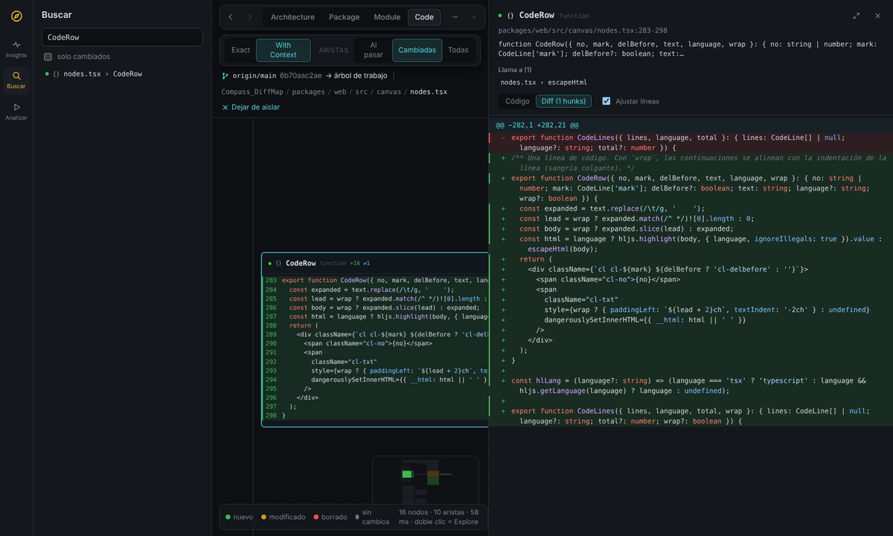
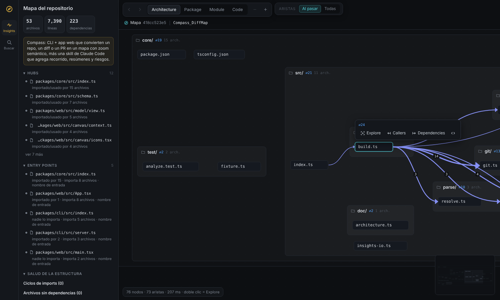
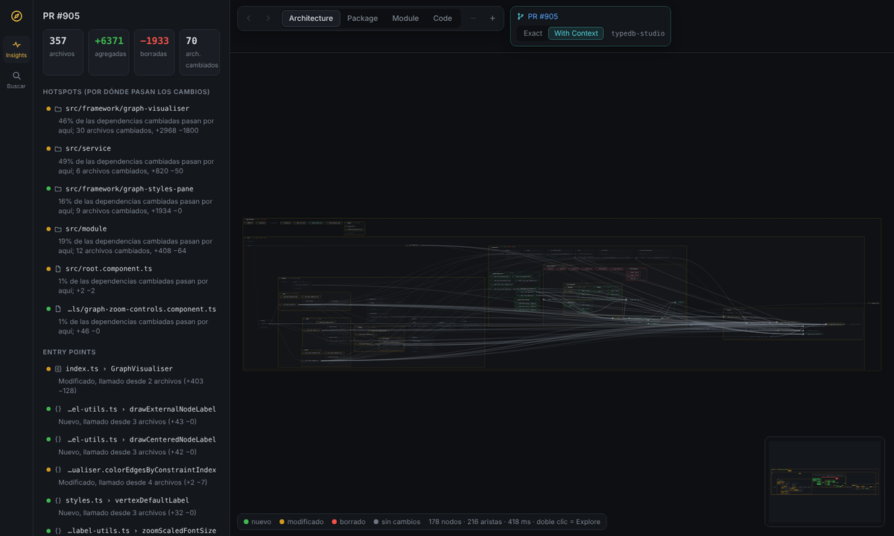

# Guía de la interfaz

Cómo leer y navegar la app de Compass (`compass serve` o un HTML de `compass export`). Las capturas son del PR del video: [typedb-studio#905](https://github.com/typedb/typedb-studio/pull/905), 70 archivos cambiados.

## Anatomía

| Zona | Qué tiene |
| --- | --- |
| **Riel izquierdo** | Insights, Buscar y Analizar (Analizar solo existe con `compass serve`; no aparece en un HTML exportado). |
| **Panel lateral** | Resumen del cambio, recorrido sugerido, riesgos, hotspots, entry points y salud de la estructura. Las secciones se pliegan; si hay recorrido, los hotspots y entry points empiezan plegados. |
| **Barra de navegación** | Atrás / adelante, los cuatro niveles (Architecture, Package, Module, Code) y − / + para bajar o subir de nivel. |
| **Filtros** | *Exact / With Context* (solo diff) y *Aristas: Al pasar / Cambiadas / Todas*. |
| **Barra de contexto** | El PR o la comparación base → head, la ruta del nodo aislado y *Dejar de aislar*. Si hay un trace de Callers o Dependencies activo, aparece aquí con *limpiar*. |
| **Lienzo** | El mapa. Abajo a la izquierda, la leyenda y el conteo de nodos y aristas; abajo a la derecha, el minimapa. |
| **Panel de código** | Se abre al hacer clic en un símbolo: firma, resumen, quién lo llama, a quién llama, el código y el diff. Ver [Panel de código](#panel-de-código). |

## Cómo leer el mapa

- **Cajas anidadas**: carpeta → archivo → clase → método. Las cadenas de carpetas de un solo hijo se compactan en una caja (`java/src/main/java/com/acme/`).
- **El punto dice el estado**: verde = nuevo, ámbar = modificado, rojo = borrado, gris = sin cambios. Los bordes son neutros a propósito; el color solo vive en el punto.
- **El anidado se lee por el fondo**: cada nivel de profundidad es un poco más claro que su padre. Lo que no cambió va con borde punteado y texto apagado.
- **Métricas del encabezado**: `+agregadas −borradas ✎modificados ⌫borrados ⇄dependencias`. En carpetas, ✎ y ⌫ cuentan archivos; en archivos y clases, símbolos. ⇄ cuenta las dependencias que cruzan el borde de esa caja.
- **Insignia amarilla con número**: el paso del recorrido de revisión que escribió la skill.
- **"+N sin cambios"**: en *With Context*, lo que no cambió y no está conectado a nada que cambió se agrupa en una ficha. Clic en ella = Explore del contenedor.

## Niveles (zoom semántico)

| Nivel | Se expanden | Se ven como fichas |
| --- | --- | --- |
| Architecture | carpetas | archivos |
| Package | carpetas y archivos | símbolos de primer nivel (clases, funciones, tipos) |
| Module | además clases, interfaces y enums | métodos y propiedades, con sus llamadas |
| Code | lo mismo que Module | cada método muestra su código con las líneas del diff |

El nodo aislado siempre se expande, sea cual sea el nivel.

## Nivel de detalle según el zoom

Además de los cuatro niveles, el lienzo se simplifica solo al alejarte:

- **De cerca** (zoom ≥ 0.75): todo el detalle.
- **Medio** (0.5 – 0.75): se ocultan las líneas secundarias de los símbolos.
- **Lejos** (< 0.5): cada contenedor con espacio muestra su nombre en grande y cada archivo se vuelve una barra del color de su estado. Funciona como un mapa de calor: se ve de un vistazo dónde se concentra el cambio.

## Aristas

Las dependencias (imports, llamadas, herencia) se agregan al nodo visible más cercano; el número sobre una arista resaltada dice cuántas agrupa.

| Modo | Qué dibuja | Default |
| --- | --- | --- |
| **Al pasar** | Solo las del nodo bajo el mouse (incluye su contenido), en azul | Vista completa |
| **Cambiadas** | Las que tocan algo que cambió, tenues; las del nodo bajo el mouse en azul | Al aislar un módulo en diff |
| **Todas** | Todas, tenues | — |

Las aristas pasan por detrás de las fichas: nunca tachan un nombre. Mientras no elijas un modo, Compass usa *Al pasar* en la vista completa y *Cambiadas* al aislar.

## Acciones

| Acción | Cómo |
| --- | --- |
| **Explore** | Botón en la tarjeta al pasar el mouse, o doble clic. Aísla el nodo y baja un nivel (carpeta → Package, archivo o clase → Module, método → Code). |
| **Callers** | Resalta lo que llama al nodo desde fuera y atenúa el resto. Otro clic lo apaga. |
| **Dependencies** | Lo mismo, hacia lo que el nodo usa. |
| **Ver código** | Ícono `<>` en la tarjeta, o clic en un símbolo: abre el panel de código. |
| **Ir a un insight** | Clic en cualquier elemento del panel: aísla su contenedor, elige el nivel adecuado y lo centra. |
| **Navegar** | Arrastrar = mover, rueda = zoom, minimapa = saltar. Atrás / adelante recorre el historial de aislamientos y niveles. |
| **Buscar** | Riel → Buscar: por nombre o ruta, con filtro *solo cambiados*. |

## Panel de código

- **Ancho ajustable**: arrastra su borde izquierdo (se ilumina al pasar el mouse). Va de 380 px al 70% de la ventana, para que el mapa nunca quede con menos del 30%. Doble clic en el borde = ancho por defecto (480 px); el botón ⤢ del encabezado lo amplía al máximo y lo regresa.
- **Ajustar líneas** (activado por defecto): las líneas largas se parten dentro del panel en vez de pedir scroll horizontal. La continuación se alinea con la indentación de su propia línea, más dos espacios, para no perder la estructura de bloques; el número de línea solo aparece en el primer renglón y el fondo verde/rojo cubre la línea completa. Aplica en *Código* y en *Diff*. Apagado, el panel muestra cada línea completa con scroll horizontal.
- El ancho y el ajuste se recuerdan en el navegador.
- Dentro del lienzo (nivel Code) las líneas largas siguen recortándose con "…": el layout calcula la altura de cada caja antes de dibujarla. Para leerlas completas, abre el panel.

## Cámara inicial

Al abrir o cambiar de vista, Compass encuadra todo si cabe a escala legible. Si no cabe, centra el primer paso del recorrido (o el hotspot principal, o el primer entry point) a escala legible, y el resto queda a mano en el minimapa. Al ir a un insight, encuadra ese nodo.

## Flujo de revisión recomendado

Es el del video, y el que propone la skill en su recorrido:

1. **Vista general** en Architecture: ¿dónde se concentra el color?
2. **Hotspot**: clic en el primero del panel. Con *Cambiadas* se ve por dónde entran y salen los cambios.
3. **Entry points** del módulo: Explore sobre la clase o el archivo para bajar a Module.
4. **Código**: Code o clic en el método sospechoso. En el panel, *Lo llaman* dice a quién afecta el cambio.
5. **Riesgos**: revisa los que señaló la skill; también aparecen en la tarjeta de cada nodo.

## Modo mapa (repo completo)

Sin diff no hay colores de estado. El panel muestra hubs (lo más importado), entry points, ciclos de imports, archivos sin dependencias y violaciones de las reglas de `compass.config.json`. Las aristas empiezan en *Al pasar*. *Analizar → Documentar estructura* escribe `docs/ARCHITECTURE.md` en el repo.

## Por qué se ve así

La versión 0.1 encuadraba el árbol completo y dibujaba todas las aristas; el resultado era ilegible en PRs grandes:

Los principios de la v0.2, tomados de la referencia:

1. **Escala legible primero**: nunca abrir con texto que no se lee; mejor mostrar lo importante y dejar el resto en el minimapa.
2. **Un solo canal para el estado**: el punto. Bordes neutros y fondos por profundidad para la estructura.
3. **Aristas bajo demanda**: son la información más valiosa y también la más ruidosa; aparecen cuando las pides.
4. **Detalle proporcional al zoom**: de lejos módulos, de cerca código.
5. **El panel acompaña, no compite**: listas cortas, secciones plegables, una línea por razón.
